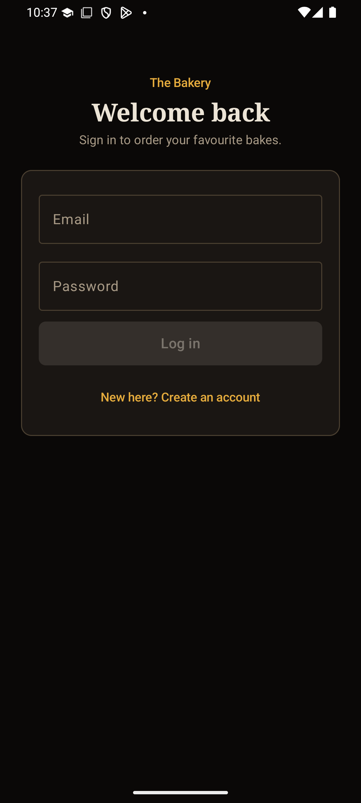
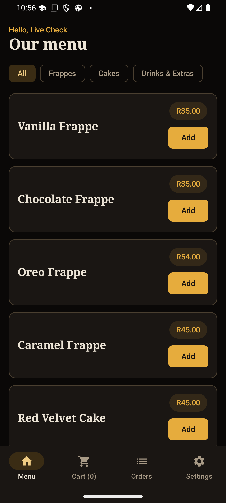
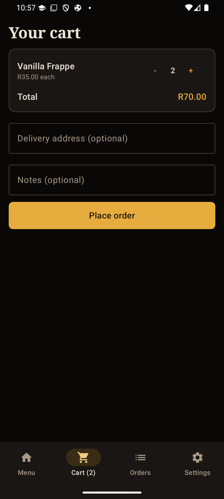
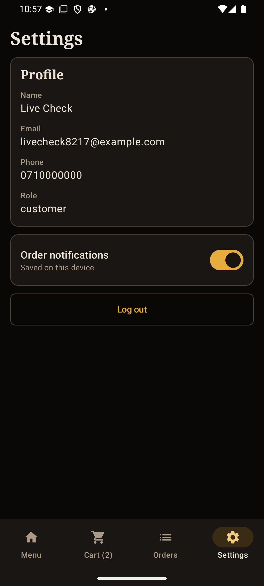
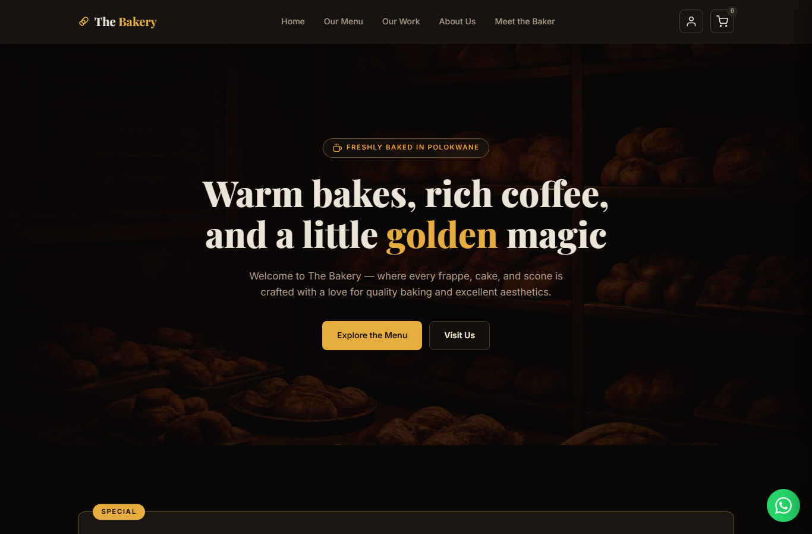
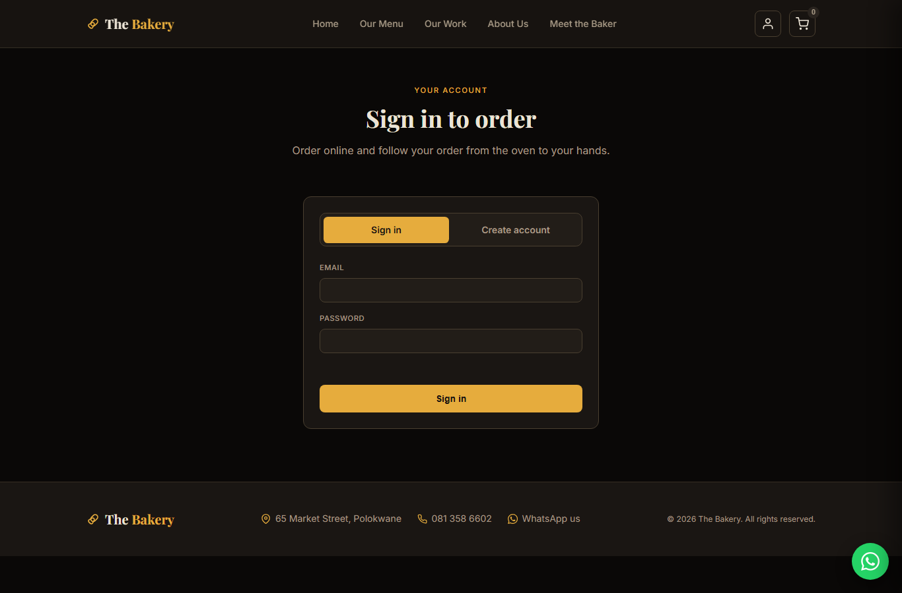
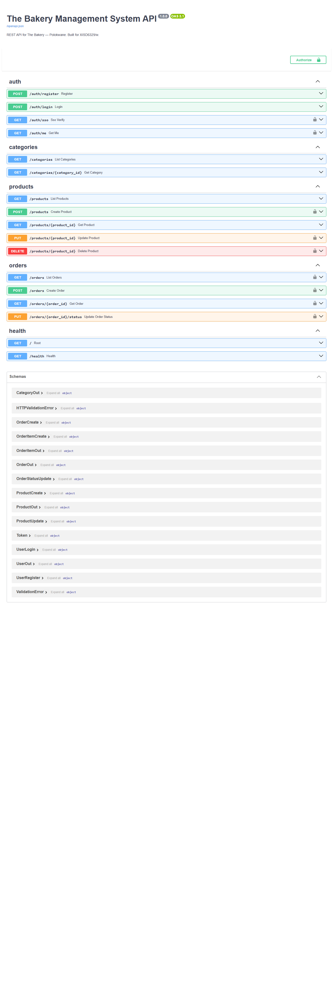
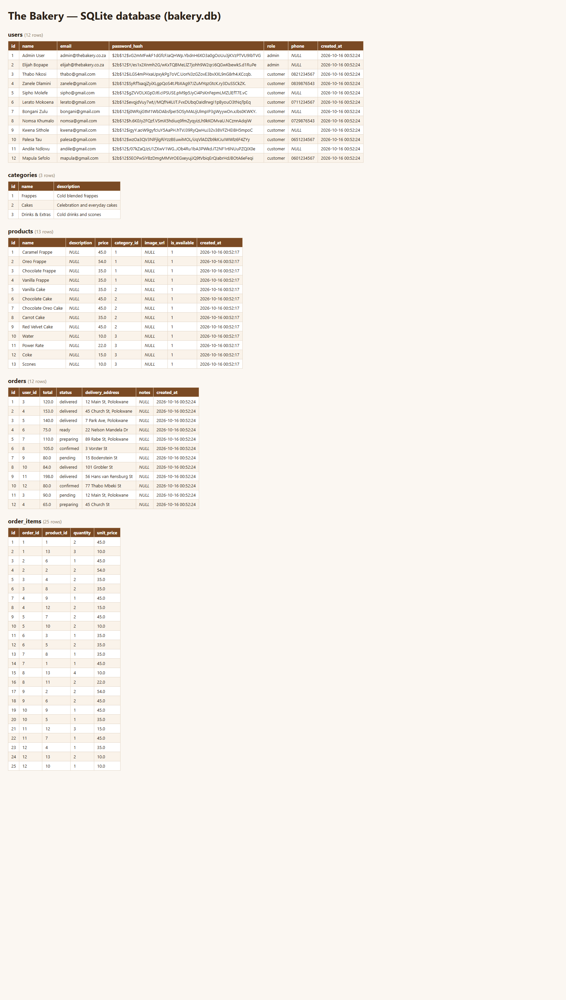
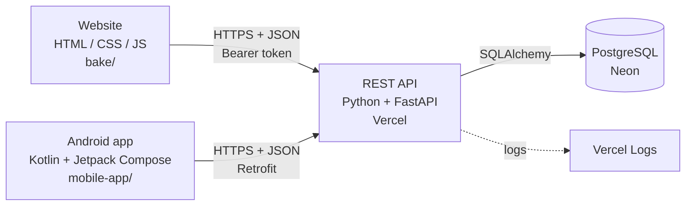

# The Bakery Management System

A website and Android app for **The Bakery, Polokwane**. Customers browse the menu, sign up and
place orders; staff manage the menu and move orders from the oven to the customer. Both apps
share one REST API and one online PostgreSQL database.

[](https://github.com/ElijahBopape/the-bakery-management-system/actions/workflows/backend.yml)
[](https://github.com/ElijahBopape/the-bakery-management-system/actions/workflows/android.yml)
[](https://github.com/ElijahBopape/the-bakery-management-system/actions/workflows/web.yml)

| | |
|---|---|
| **Demo video** | https://youtu.be/_IyT-tbq1Rw?si=AKq-o2toBcZcYCS5 *(Task 3 video link to be updated)* |
| **Live API** | https://the-bakery-api.vercel.app — interactive docs at [`/docs`](https://the-bakery-api.vercel.app/docs) |
| **Release notes** | [RELEASE_NOTES.md](./RELEASE_NOTES.md) — every update since the prototype |
| **Module** | XISD6329/w — Work Integrated Learning |

---

## 1. Purpose of the app

The Bakery took orders by phone, WhatsApp and walk-in, and kept track of them on paper. That made
it hard to know what was ordered, what was ready and what sold well. This system:

- gives customers a **live menu** and lets them **order online** from a phone or computer;
- lets customers **follow their orders** (pending → confirmed → preparing → ready → delivered);
- gives staff a **dashboard** to add, change, hide and price menu items and update orders;
- keeps every customer, product and order in **one online database**, so the website and the app always agree.

## 2. Screenshots

### Android app

| Login | Menu | Cart | Settings |
|---|---|---|---|
|  |  |  |  |

### Website

| Home page | Sign in / create account |
|---|---|
|  |  |

### API and database

| API documentation (`/docs`) | Database tables with records |
|---|---|
|  |  |

## 3. Design

### Architecture



### Design considerations

| Decision | Why |
|---|---|
| **One API for both apps** | The website and app can never disagree about the menu, prices or orders, and every rule lives in one place. |
| **FastAPI (Python)** | Validates every request automatically and generates the `/docs` page the team uses to test calls. |
| **PostgreSQL, 5 related tables** | users, categories, products, orders, order_items. Each order line stores the price paid, so later price changes don't rewrite history. |
| **Passwords hashed with bcrypt** | Plain passwords are never stored, as the brief requires. |
| **JWT tokens + SSO** | Sign-in returns a token that lasts 7 days. On start-up the website and app call `GET /auth/sso`, so a returning user is signed in automatically. |
| **Prices come from the server** | Order totals are worked out from the database, so a customer can't change what they pay. |
| **Hide, don't delete** | Products that are on past orders can't be deleted (409), only hidden, so order history never breaks. |
| **Works when the server is down** | The website keeps a built-in menu and offers WhatsApp ordering if the API can't be reached. |
| **Logging with request IDs, privacy-safe** | Every call is logged with its status and time. Emails are masked and passwords/tokens never logged (POPIA). |
| **Free hosting** | Vercel (API) + Neon (database) cost nothing and wake in about a second. We moved here from Railway when its trial ended (see release notes). |
| **Dark, warm visual style** | Gold on dark brown matches the bakery's shop and branding; the same palette is used on the website and app. |

### Repository structure

```
the-bakery-management-system/
├── backend/            REST API (Python + FastAPI) — see backend/README.md
│   ├── main.py         app, CORS, request logging
│   ├── routers/        auth, categories, products, orders
│   ├── models.py       database tables
│   ├── seed.py         real menu + sample data
│   └── tests/          45-check API smoke test
├── bake/               Website (HTML / CSS / JavaScript)
├── mobile-app/         Android app (Kotlin + Jetpack Compose)
├── documentation/      wireframes, sitemaps, images used in this README
├── .github/workflows/  GitHub Actions (backend, android, web)
├── RELEASE_NOTES.md
└── README.md
```

## 4. How we use GitHub

- **One repository** for the API, website and app, so a change that touches all three (like the new
  server address) is one pull request.
- **Branches per task**, named by type: `fix/free-hosting`, `docs/task3-elijah`, `mobile-app`,
  `website-update`. Nobody works directly on `main`.
- **Pull requests** into `main`. GitHub Actions must pass before merging.
- **Clear commit messages** in the form `type(area): what changed`, e.g.
  `fix(backend): block deleting a product that is on existing orders`.
- **No secrets and no zip files** in the repo: `.env`, database files, signing keys and
  `keystore.properties` are in `.gitignore`. Server secrets live in Vercel's settings.
- **Azure DevOps** holds the Kanban board, and `azure-pipelines.yml` mirrors the CI there.

## 5. How we use GitHub Actions

Three workflows run on every push and pull request to `main`, so we know the code works on a clean
machine, not just on one laptop.

| Workflow | File | What it does |
|---|---|---|
| **Backend CI** | [`backend.yml`](.github/workflows/backend.yml) | Lints Python with Ruff, installs the API on Python **3.11 and 3.12**, seeds a fresh database, starts the server and runs the **45-check API smoke test** (register, login, SSO, orders, admin rules, CORS). |
| **Android CI** | [`android.yml`](.github/workflows/android.yml) | Sets up Java and Gradle, runs Android **lint**, the **JUnit unit tests**, and **builds the APK**. The APK and test reports are uploaded as downloadable artifacts. |
| **Web CI** | [`web.yml`](.github/workflows/web.yml) | Checks every JavaScript file for syntax errors and lints the HTML pages with **HTMLHint**. |

Results are on the [Actions tab](https://github.com/ElijahBopape/the-bakery-management-system/actions)
and in the badges at the top of this page.

## 6. API

Base URL (live): `https://the-bakery-api.vercel.app` · local: `http://localhost:8000`

| Method | Endpoint | Auth | Description |
|--------|----------|------|-------------|
| POST | `/auth/register` | — | Register a new customer (returns a token) |
| POST | `/auth/login` | — | Log in, returns a JWT token |
| GET | `/auth/sso` | Bearer | Check a saved token (SSO on start-up) |
| GET | `/auth/me` | Bearer | Current user's profile |
| GET | `/categories` | — | All menu categories |
| GET | `/categories/{id}` | — | One category |
| GET | `/products` | — | Menu (`?category_id=`, `?available_only=false`) |
| GET | `/products/{id}` | — | One product |
| POST | `/products` | Admin | Add a product |
| PUT | `/products/{id}` | Admin | Change a product |
| DELETE | `/products/{id}` | Admin | Delete a product (409 if it is on orders) |
| POST | `/orders` | Bearer | Place an order |
| GET | `/orders` | Bearer | Orders (own; all for admin) |
| GET | `/orders/{id}` | Bearer | One order |
| PUT | `/orders/{id}/status` | Admin | Change an order's status |

Where each app connects:

| Part | File |
|------|------|
| Server address (website) | `bake/api.js` → `API_BASE` (one line) |
| Server address (app) | `mobile-app/app/src/main/java/com/bakery/app/data/BakeryApi.kt` → `BAKERY_BASE_URL` (one line) |
| Website menu / cart / account / staff | `bake/public-menu.js`, `cart.js`, `account.js`, `admin.js` |

### Logging

The API logs one line per request, plus events such as sign-ups, failed logins, new orders and
status changes. View them in **Vercel → the-bakery-api → Logs**, or in the terminal when running locally.

```
INFO bakery.routers.auth | Login succeeded user_id=13 role=customer
INFO bakery.main | POST /auth/login -> 200 (294 ms) [req 05da020a]
INFO bakery.routers.orders | Order placed order_id=13 user_id=13 items=2 total=R120.00
```

## 7. Running and testing

```bash
cd backend
python -m venv .venv && .venv\Scripts\activate      # macOS/Linux: source .venv/bin/activate
pip install -r requirements.txt
python seed.py                                      # menu + sample accounts (safe to repeat)
uvicorn main:app --reload --port 8000               # docs at http://localhost:8000/docs
python tests/api_smoke_test.py                      # in a 2nd terminal: "45 checks, 0 failed"
```

- **Website:** set `API_BASE` in `bake/api.js` to the localhost line, then serve `bake/` with `python -m http.server 5500`.
- **Android app:** open `mobile-app/` in Android Studio and run it. A signed release build needs a
  `keystore.properties` file (kept off GitHub); see the comment at the top of `app/build.gradle.kts`.
- **Deploying the API:** see [`backend/README.md`](./backend/README.md).

## 8. Team

| Member | Task 3 responsibility |
|---|---|
| Matome Elijah Bopape | Backend and API, hosting, README, release notes, backend comments and logging |
| Isam Eltawil | Android app, signed APK, Google Play Console, Kotlin comments and logging |
| Matsobane Boshomane (Smilo) | Website updates from feedback, website screenshots, unit tests, website comments |
| Tlou Pheme | Demonstration video, GitHub Actions evidence, final push |
| Mahlatse Mphelo | Business Analyst |

<details>
<summary>Task 2 roles and contributions</summary>

| Member | Area | What they delivered |
|---|---|---|
| Matome Elijah Bopape | Database and API | Database tables, the hosted API and its endpoint list |
| Isam Eltawil | Android app | Kotlin app: screens, register and login, SSO, settings and connection to the API, tested on a real phone |
| Matsobane Boshomane | Website and testing | Website connected to the same API, unit tests, bug testing and keeping the schedule updated |
| Tlou Pheme | DevOps and README | GitHub Actions for build and tests, Azure DevOps Kanban board, repository structure and README |

</details>

## 9. Background

The system builds on the requirements and design produced for The Bakery in XISD5319, extended for
XISD6329 to include both a website and a mobile app connected to one hosted database.
